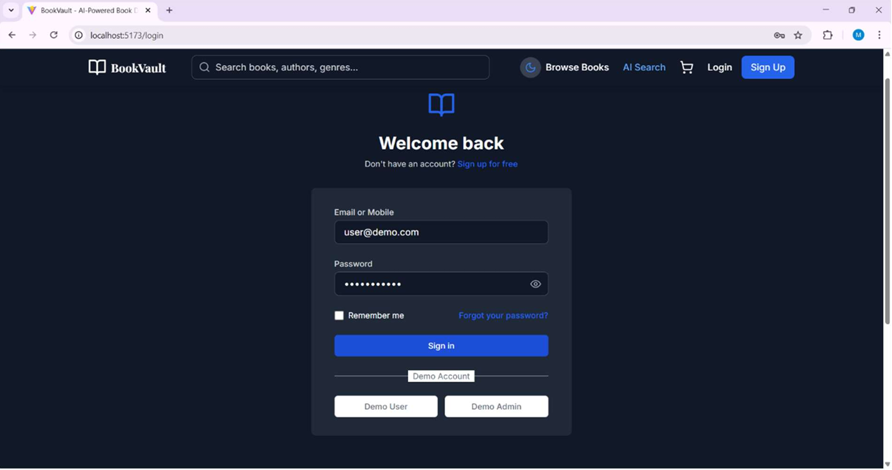
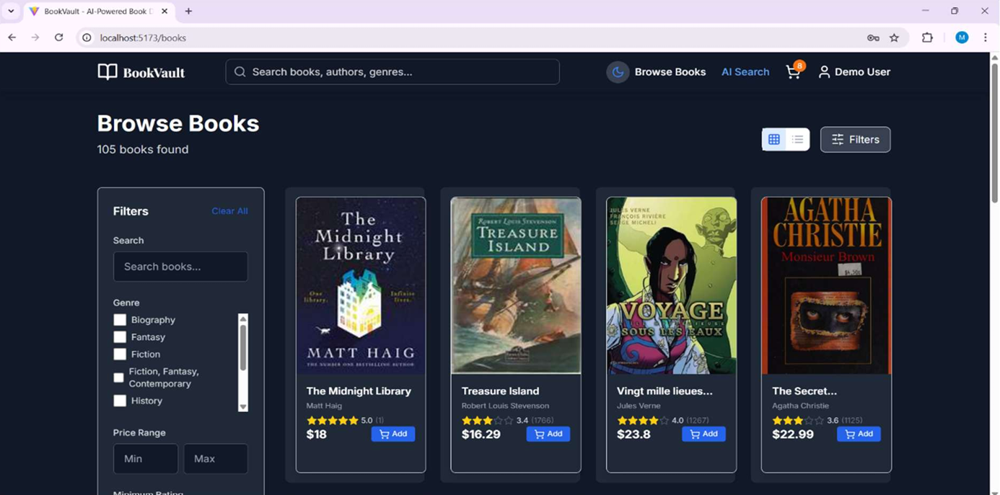
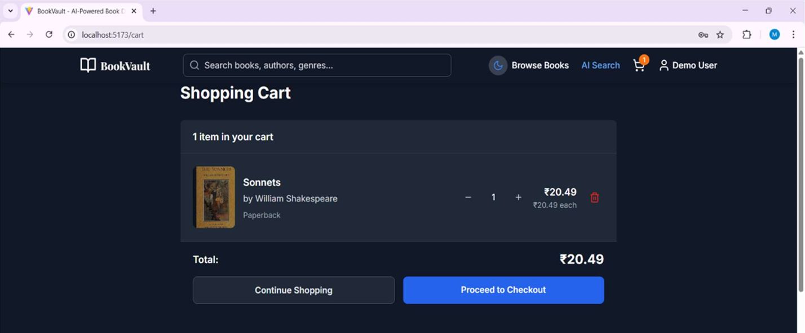
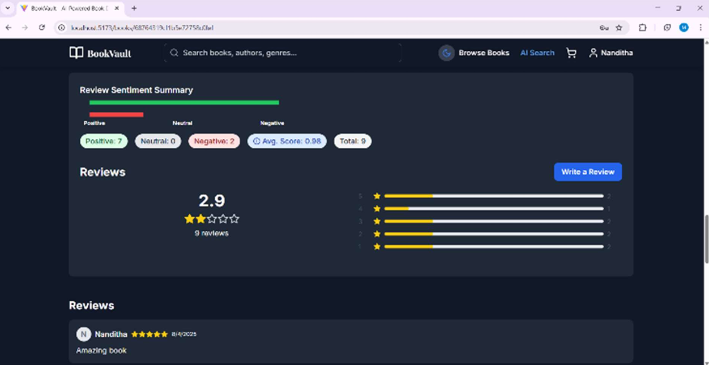
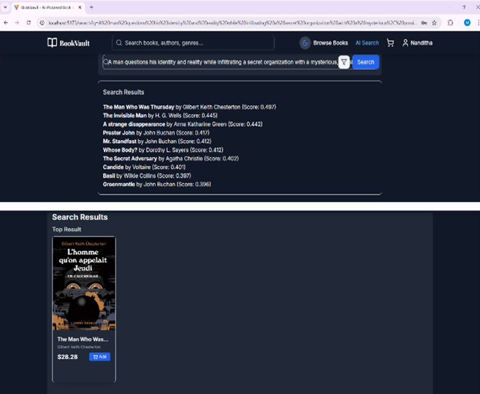
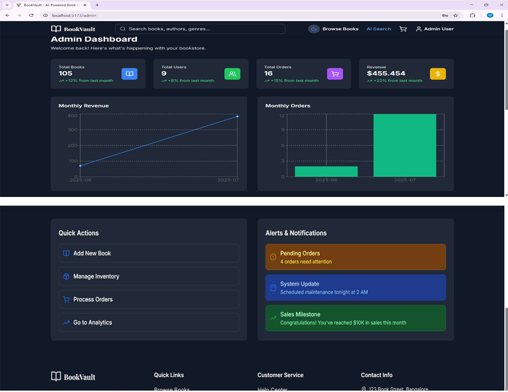
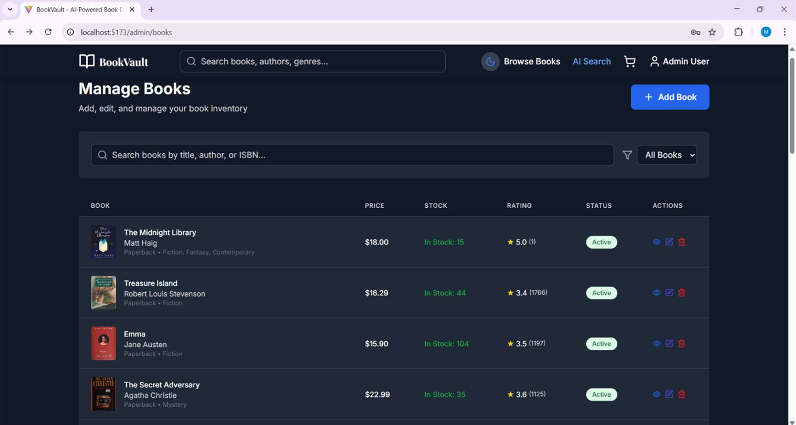
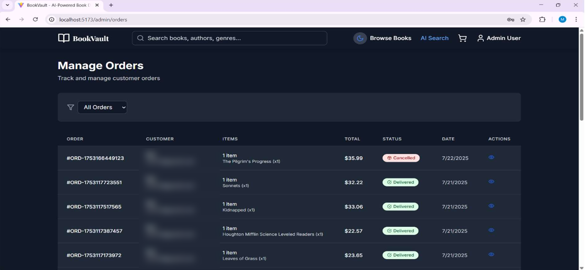
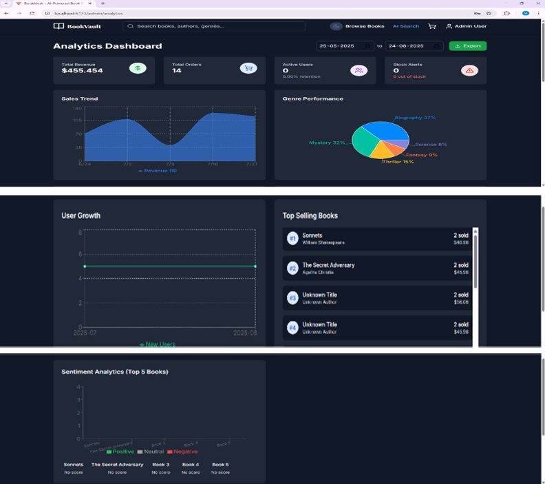

# 📚 BookVault: AI-Powered Online BookStore

BookVault is a full-stack online bookstore where users can browse books, add them to a cart, review them, and check out. It also includes **AI-based semantic search**, a **hybrid recommendation system** that explains its suggestions, and an **admin dashboard** for managing books, orders, and analytics.

I built this project on my own to practice full-stack development with **React, FastAPI, and MongoDB**. The system was also published as a research paper (see [Research Paper](#-research-paper)).

---

## ✨ Features

### For users
- Browse the book catalog with filters (genre, price range, rating) and grid/list views
- **AI semantic search**: describe a book in your own words and get matching results with similarity scores
- **Personalized recommendations** with a short reason, such as "Because you liked Sonnets", and a thumbs up/down feedback option
- Book details page with related books and a wishlist button
- Reviews and ratings, with a **review sentiment summary** (positive, neutral, negative)
- Shopping cart with quantity updates and a checkout workflow
- Register, log in, and log out, with demo accounts for quick testing
- Dark theme

### For admins
- Dashboard with total books, users, orders, and revenue, plus monthly charts
- Add, edit, and delete books and manage stock
- View and manage customer orders (delivered, cancelled, and so on)
- Analytics dashboard: sales trend, genre performance, user growth, top-selling books, and review sentiment

---

## 🛠️ Tech Stack

| Part | Technology |
| --- | --- |
| Frontend | React, TypeScript, Vite, Tailwind CSS |
| Backend | Python, FastAPI, Node.js |
| Database | MongoDB |
| AI / Search | Hybrid recommendation, semantic search, review sentiment analysis |
| Tools | Git, GitHub, Postman, VS Code |

---

## 🤖 How the Recommendation Works

The recommendation module uses a **hybrid approach**, which combines:

1. **Content-based filtering**: suggests books similar to the ones a user has viewed or liked.
2. **Collaborative filtering**: suggests books that other users with similar interests liked.

Each suggestion comes with a short explanation, so users can see why a book was recommended.

---

## 📸 Screenshots

### Home and login

| Home page | Login with demo accounts |
| --- | --- |
|  |  |

### Browsing and buying

| Browse books with filters | Book details |
| --- | --- |
|  |  |

| Shopping cart | Review sentiment summary |
| --- | --- |
|  |  |

### AI features

| AI semantic search | Personalized recommendations |
| --- | --- |
|  |  |

### Admin panel

| Admin dashboard | Manage books |
| --- | --- |
|  |  |

| Manage orders | Analytics dashboard |
| --- | --- |
|  |  |

---

## 📁 Project Structure

```
AI-powered_Online_BookStore_System/
├── src/               # React + TypeScript frontend (pages, components)
├── server/            # Backend APIs (authentication, books, cart, reviews)
├── semantic-search/   # Semantic search module
├── index.html         # Frontend entry point
├── package.json       # Frontend dependencies and scripts
├── vite.config.ts     # Vite configuration
└── tailwind.config.js # Tailwind CSS configuration
```

---

## 🚀 Getting Started

### Prerequisites

Make sure you have these installed:

- Node.js and npm
- Python 3.9 or higher
- MongoDB (local installation or MongoDB Atlas)
- Git

### 1. Clone the repository

```bash
git clone https://github.com/NandithaBM/AI-powered_Online_BookStore_System.git
cd AI-powered_Online_BookStore_System
```

### 2. Run the frontend

```bash
npm install
npm run dev
```

The frontend runs at `http://localhost:5173`.

### 3. Run the backend

```bash
cd server
pip install -r requirements.txt
uvicorn main:app --reload
```

The backend runs at `http://127.0.0.1:8000`.
FastAPI documentation is available at `http://127.0.0.1:8000/docs`.

> Check the file name (`main.py`) and the install step against your `server` folder, and change them if they are different.

### 4. Environment variables

Create a `.env` file in the `server` folder:

```
MONGODB_URI=your_mongodb_connection_string
SECRET_KEY=your_secret_key
```

> Never upload your real `.env` file to GitHub.

### 5. Try the demo

On the login page, use the **Demo User** or **Demo Admin** button to explore the app without creating an account.

---

## 📄 Research Paper

**AI-Powered Book Discovery: Integrating Semantic Search, Hybrid Recommendation, and Explainable AI in a Full-Stack Platform**
Published in the *International Journal for Multidisciplinary Research (IJFMR)*.
[Read the paper](PASTE_PAPER_LINK_HERE)

---

## 🔮 Future Improvements

- Add online payment integration
- Add automated tests with pytest
- Deploy the application online

---

## 👩‍💻 Author

**Nanditha B M**
MCA Graduate | Aspiring Software Engineer

- GitHub: [NandithaBM](https://github.com/NandithaBM)
- LinkedIn: [Add your LinkedIn link]
- Email: [Add your email]
